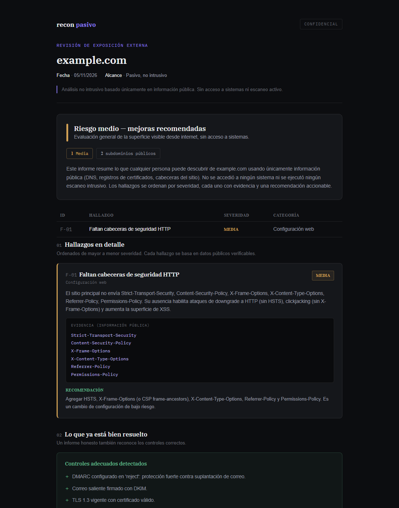

# recon-pasivo

Herramienta en Python que releva la **exposición externa de un dominio usando solo fuentes
públicas** y genera un informe HTML con hallazgos priorizados por severidad.

> *Passive external-exposure recon for a domain (DNS, email auth, TLS, HTTP headers,
> Certificate Transparency, Shodan InternetDB, VirusTotal) with a prioritized HTML report.*



## Qué revisa

| Módulo | Qué mira | Fuente |
| :--- | :--- | :--- |
| `dns_email` | SPF, DKIM (selectores comunes), DMARC, DNSSEC | DNS público |
| `http_headers` | Cabeceras de seguridad (HSTS, CSP, X-Frame-Options, etc.) y fingerprint de tecnologías | Home del sitio |
| `tls` | Protocolo, vencimiento y emisor del certificado | Handshake TLS |
| `subdomains_ct` | Subdominios publicados y nombres sensibles (`dev`, `staging`, `admin`, etc.) | Certificate Transparency (certspotter, con crt.sh de respaldo) |
| `emails` | Correos publicados en el sitio | Home del sitio |
| `shodan_mod` | Puertos y servicios ya indexados, filtrando las IPs de Cloudflare | Shodan InternetDB (gratis, sin key) |
| `virustotal` | Reputación del dominio (opcional) | API de VirusTotal |
| `dorks` | Consultas de Google para revisar a mano | Se generan, no se ejecutan |

`report.py` convierte la evidencia en hallazgos con severidad (crítica, alta, media, baja),
impacto y recomendación, calcula un semáforo global y arma un HTML autocontenido que se puede
imprimir a PDF.

## Uso

```bash
pip install -r requirements.txt
cp .env.example .env          # opcional: VT_API_KEY para el módulo de reputación

python passive_recon.py example.com      # -> out/example-com.json (evidencia cruda)
python report.py out/example-com.json    # -> out/informe-example-com.html
```

## Uso responsable

Todo lo que corre es **pasivo**: consultas a datos públicos o a bases ya recolectadas por
terceros. No hay escaneo de puertos, fuerza bruta, pruebas con credenciales ni acceso a la
infraestructura del objetivo. Aun así, usala sobre dominios propios o con autorización.
Cualquier validación activa de los hallazgos requiere un acuerdo de alcance por escrito.

## Diseño

- Cada módulo expone `run(dominio)` y devuelve un diccionario; si una fuente falla o no hay key,
  el módulo degrada y el informe sigue.
- Las IPs detrás de Cloudflare se descartan antes de consultar Shodan, para no reportar la CDN
  como si fuera el origen.
- Las reglas de severidad están en `report.py`, separadas de la recolección: se pueden ajustar
  sin tocar los módulos.

## Licencia

MIT
